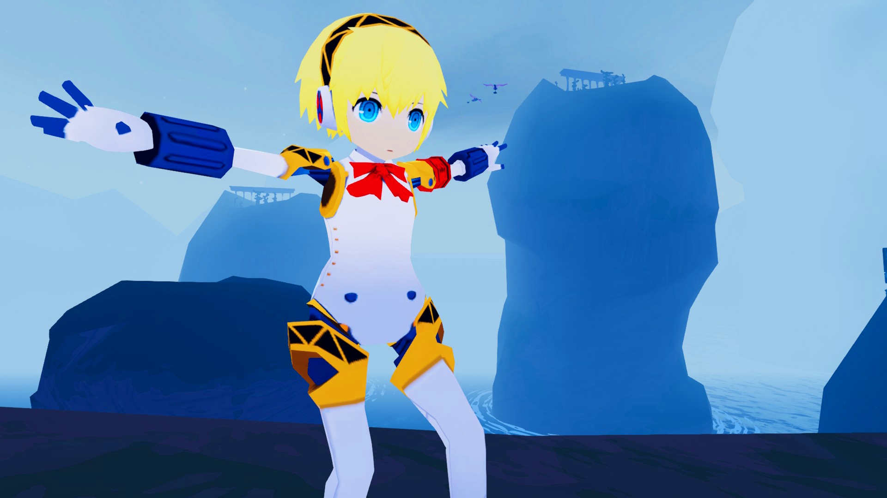
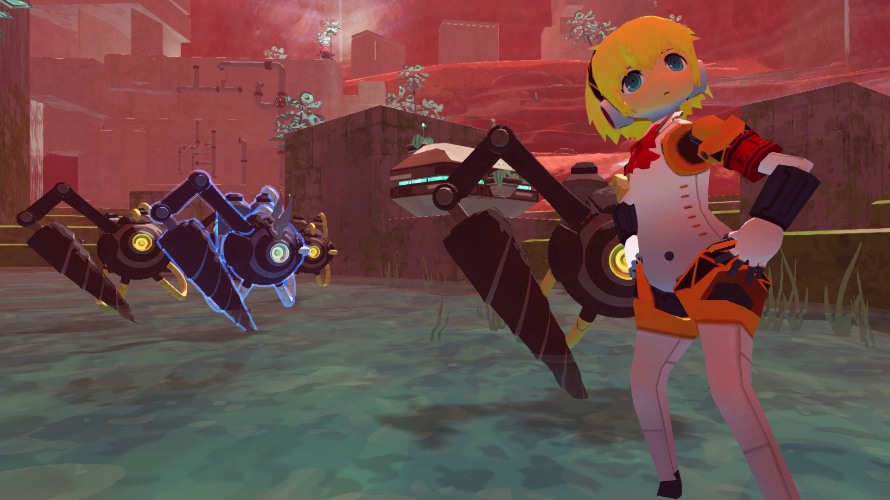

# Jungian Commando Aigis (ROR2 Persona 3 Mod)

"You can close your eyes. I'll always remain here by your side."
The most celebrated robot girl deploys to Petrichor!
PLEASE READ RECOMMENDED.

 
 

## Dependencies

* R2API\_Skins
* bbepis-BepInExPack

## RECOMMENDED

* ItemDisplayToggle (To make items not visible on the character body. Items can look weird because the rig is not ready for them.
                               I keep some of the original artstyle by not doing any extreme changes to the body of the character)

 

## Credits and Thanks

* Model: Exported from Persona Q 2 and modified/upscaled/rigged by me.

